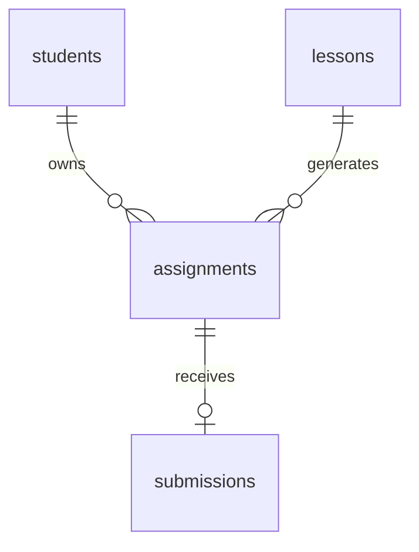

# Bài tập của tôi — IELTS Master

Bài test Junior Full-stack triển khai bằng Next.js App Router, TypeScript strict, Route Handler và dữ liệu mock ở server. Đặc tả gốc: `Ke_hoach_Bai_test_Bai_tap_cua_toi.docx`.

## Chạy cục bộ

Yêu cầu Node.js 22.13+ hoặc Node.js 24 LTS và npm. Không cần `.env`, database hoặc tài khoản dịch vụ.

```bash
npm ci
npm run dev
```

Mở http://localhost:3000. Trên PowerShell chặn `npm.ps1`, dùng `npm.cmd` thay `npm`.

```bash
npm test
npm run typecheck
npm run build
npm start
```

`npm test`: kiểm thử unit/service/Route Handler. `typecheck`: kiểm tra kiểu. `build` và `start`: build rồi chạy bản production.

Kiểm thử trình duyệt: `npm run build && npm run test:e2e`. Cấu hình mặc định dùng Microsoft Edge đã cài trên máy. Nếu máy không có Edge, cài Edge hoặc thay `channel` trong `playwright.config.ts` theo trình duyệt có sẵn. Playwright tự khởi động ứng dụng production ở cổng 3100 riêng để tránh dùng nhầm server đang chạy.

## Dữ liệu và kết quả kỳ vọng

Mốc cố định **11/11/2026 09:00 GMT+7** (`2026-11-11T09:00:00+07:00`), không lấy giờ hệ thống để tính đáp án. Giao diện sắp theo mã bài tăng dần.

| Bài | Học viên | Hạn GMT+7 | Nộp GMT+7 | Kết quả |
| --- | --- | --- | --- | --- |
| A01 | S01 | 13/11/2026 23:59 | — | Chưa nộp |
| A02 | S01 | 09/11/2026 23:59 | — | Quá hạn |
| A03 | S01 | 10/11/2026 23:59 | 10/11/2026 20:00 | Đã nộp |
| A04 | S01 | 08/11/2026 23:59 | 10/11/2026 12:00 | Đã nộp + Nộp trễ |
| B01 | S02 | 13/11/2026 23:59 | — | Không trả về cho S01 |

`now > dueAt` mới quá hạn; nộp đúng hạn vẫn đúng giờ. Có lần nộp luôn là “Đã nộp”; nộp sau hạn thêm nhãn “Nộp trễ”. Không lưu status trong dữ liệu vì đó là giá trị tính toán.

## API và cách tránh lộ S02

`GET /api/assignments` trả `{ now, data: AssignmentDTO[] }`, đúng bốn bài của S01. `getCurrentStudent()` nằm ở server, cố định S01. Handler không đọc học viên từ query, body hoặc cookie. Ví dụ `/api/assignments?studentId=S02` vẫn trả A01–A04.

Service lọc quyền sở hữu **trước** khi ghép lần nộp và dựng DTO. Chỉ trả `id`, `title`, `dueAt`, `submittedAt`, `status`, `isLate`; không trả email hoặc khóa sở hữu. Các module dữ liệu, auth và service đều dùng `server-only`, ngăn import vào client bundle. Response có `Cache-Control: private, no-store, max-age=0` và `Vary: Cookie`.

Đây là mô phỏng danh tính theo đề, chưa phải cơ chế đăng nhập production.

## Cấu trúc và thiết kế dữ liệu

- `src/app/`: trang, layout, CSS và API.
- `src/components/`: danh sách, badge, dashboard và InfoCard chuyển thể từ Coursi LMS.
- `src/lib/`: trạng thái, mốc giờ, định dạng GMT+7 và DTO.
- `src/server/`: tài khoản giả lập, service và bốn bảng mock.
- `tests/`: Vitest; `tests/e2e/`: Playwright.
- `docs/schema.sql`, `docs/seed.sql`: schema PostgreSQL và đủ dữ liệu giả tham chiếu; không cần chạy để dùng ứng dụng.



`submissions.assignment_id` là UNIQUE, mỗi bài tối đa một lần nộp. Xem [nguồn mã mở và quyết định thiết kế](docs/open-source.md) để biết phần chuyển thể từ Coursi LMS, SWR, Lucide và cách kết hợp UI UX Pro Max với Hallmark.

## Kiểm tra

- T01–T06: bốn trạng thái mẫu và biên bằng hạn nộp.
- T07–T08: service tách đúng S01/S02; học viên không tồn tại trả danh sách rỗng.
- T09: API trả trạng thái đúng, DTO tối giản và header chống cache.
- T10: request HTTP có query/cookie S02 vẫn chỉ nhận S01.
- T11: bảng/thẻ trên 320, 375, 414, 768 và 1280px; kiểm tra không tràn ngang, nhãn nộp trễ, lọc, rỗng và lỗi/retry.

Kết quả thực tế: **18 test Vitest + 9 test Playwright pass**, TypeScript và production build pass. Xem [biên bản kiểm tra](docs/validation.md).

## Ảnh giao diện


Ảnh mobile: [docs/screenshot-mobile.png](docs/screenshot-mobile.png).

## Phần chưa làm / hướng mở rộng

Theo phạm vi đề: chưa có database thật, đăng nhập thật, nộp file, chấm điểm hay phân trang. Không triển khai hosting vì đề không yêu cầu. Khi tích hợp đăng nhập thật, thay mock bằng phiên đã xác thực, thêm kiểm tra quyền và reset cache client khi thay tài khoản.
