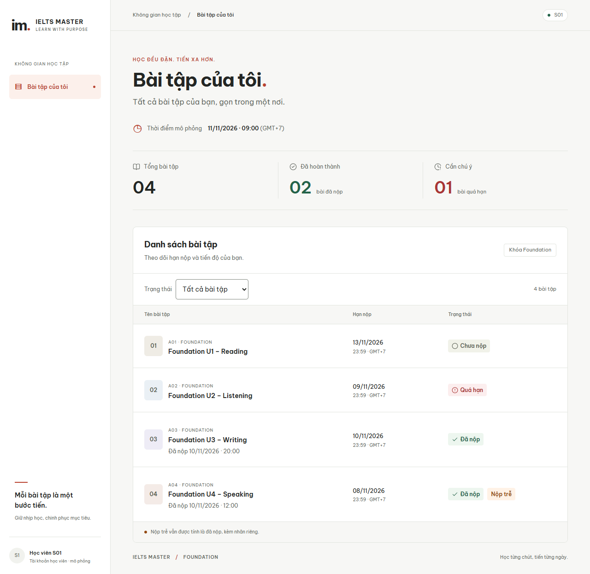

# Bài tập của tôi — IELTS Master

Ứng dụng Next.js App Router + TypeScript, dùng dữ liệu mock phía server theo tài liệu Word trong dự án.

## Cách chạy

Yêu cầu Node.js 22.13+ hoặc 24 LTS và npm. Không cần database hay file `.env`.

```bash
npm ci
npm run dev
```

Mở http://localhost:3000. Nếu PowerShell chặn `npm.ps1`, dùng `npm.cmd` thay cho `npm`.

## Cách kiểm tra

```bash
npm test
npm run typecheck
npm run build
npm run test:e2e
```

Vitest kiểm tra logic, service và API. Playwright kiểm tra giao diện, bộ lọc, lỗi/retry và cách ly S01/S02; cần Microsoft Edge, tự chạy server ở cổng 3100.

Mốc giả lập cố định: **11/11/2026 09:00 (GMT+7)**. Danh sách sắp theo mã bài:

| Bài | Kết quả kỳ vọng |
| --- | --- |
| A01 | Chưa nộp |
| A02 | Quá hạn |
| A03 | Đã nộp |
| A04 | Đã nộp + Nộp trễ |
| B01 của S02 | Không hiển thị cho S01 |

Nộp đúng bằng hạn vẫn đúng giờ; chỉ quá hạn khi `now > dueAt`. Trạng thái được tính từ thời gian, không lưu sẵn.

## Cách tránh lộ dữ liệu S02

`GET /api/assignments` lấy S01 từ `getCurrentStudent()` ở server, không lấy danh tính từ client. Service lọc bài của S01 trước khi tạo DTO; không gửi toàn bộ dữ liệu để lọc ở trình duyệt. DTO không chứa email hoặc khóa sở hữu, dữ liệu mock được bảo vệ bằng `server-only`, response có `Cache-Control: private, no-store`.

Test xác nhận thêm `?studentId=S02` hoặc cookie giả S02 vẫn chỉ trả A01–A04.

## Ảnh chụp giao diện



## Phần chưa làm

Chưa tích hợp đăng nhập thật, database thật, nộp file, chấm điểm, phân trang hoặc hosting. Danh tính S01 hiện là giả lập theo đề; khi mở rộng cần dùng phiên xác thực thật và reset cache client khi đổi tài khoản.

Dữ liệu mẫu: [TypeScript](src/server/db/seed.ts), [SQL tham chiếu](docs/seed.sql). Giao diện kết hợp UI UX Pro Max và Hallmark; phần chuyển thể mã mở được ghi tại [nguồn và giấy phép](docs/open-source.md).
